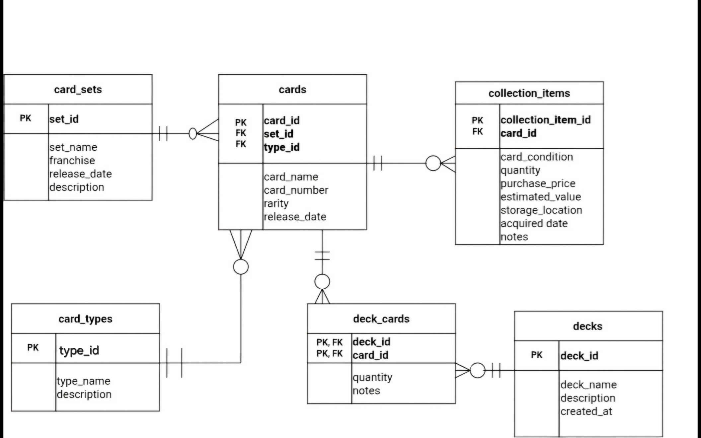
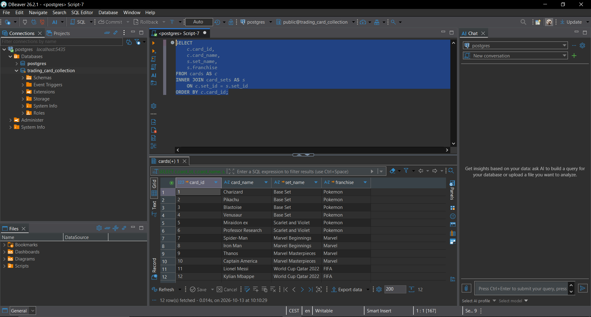
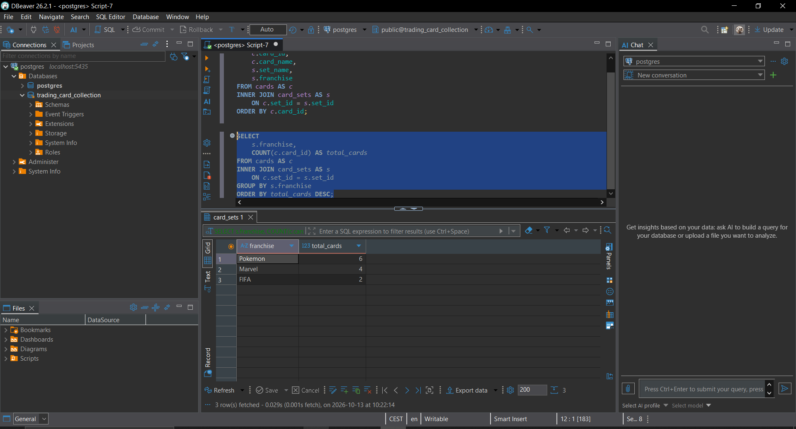
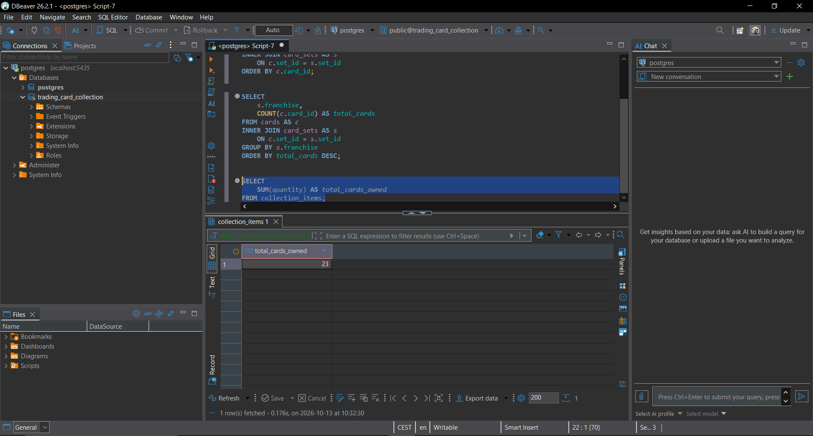
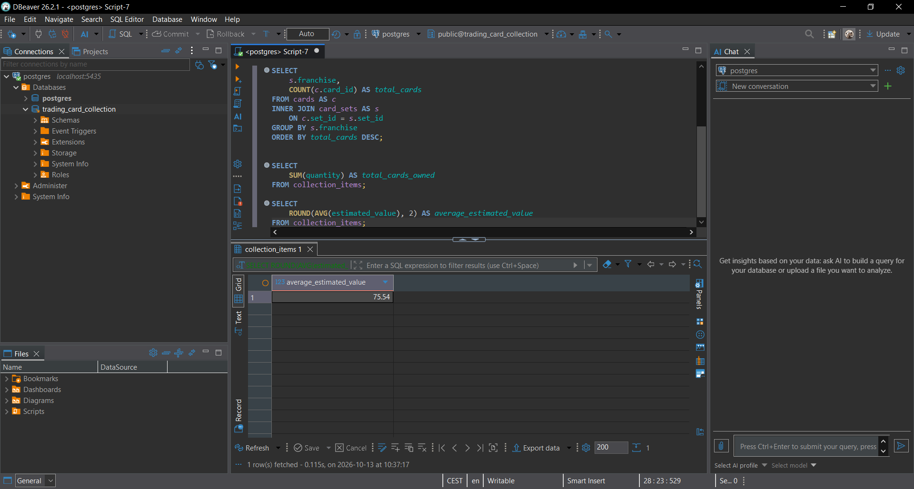
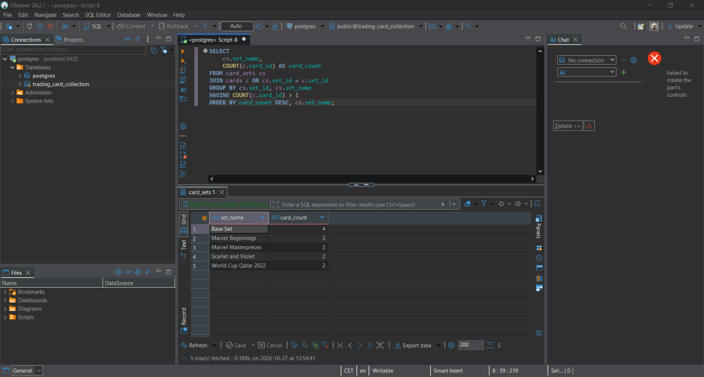
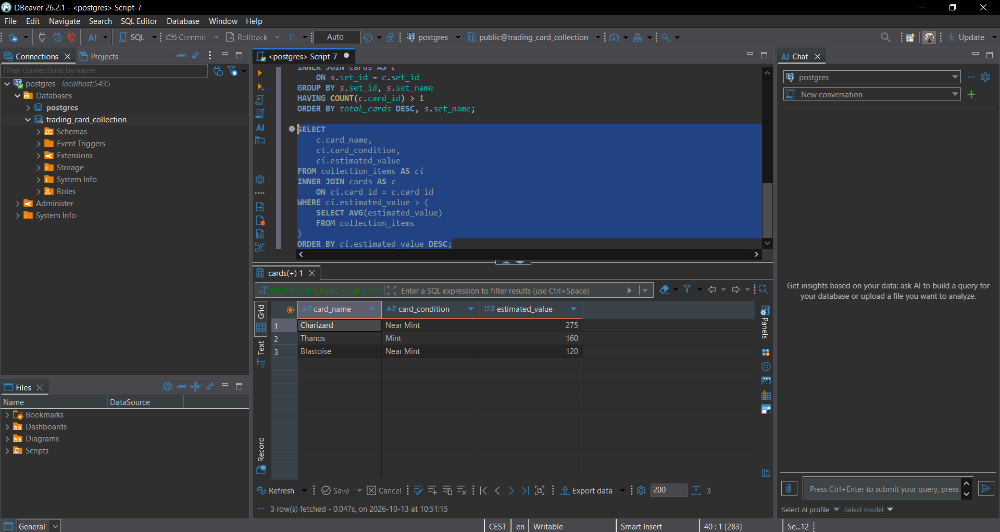
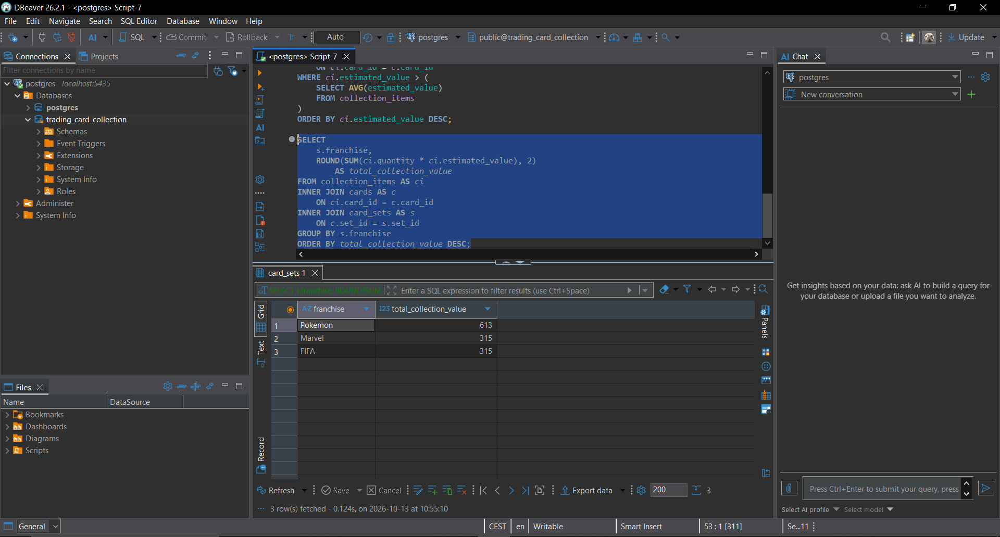
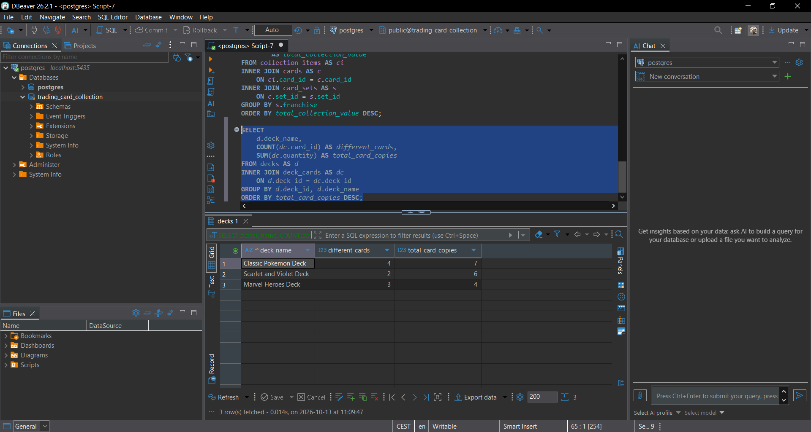

# Trading Card Collection Database

## Description

For this project I chose to make a database for my husband's trading card collection. The collection contains Pokémon, Marvel, and FIFA cards. The purpose is to keep the card information organized in one database.

## ER model

## Design decisions

The database has six tables: `card_sets`, `card_types`, `cards`, `collection_items`, `decks`, and `deck_cards`.

I separated `cards` from `collection_items` because `cards` stores general information about a published card, while `collection_items` stores information about the copies that are owned. This makes it possible to own the same card in different conditions or with different purchase prices.

One set can contain many cards, one card type can be used by many cards, and one card can have several collection items.

Cards and decks have a many-to-many relationship because a deck can contain many cards and the same card can appear in several decks. The `deck_cards` table resolves this relationship and uses `deck_id` and `card_id` as its primary key.

## Work Requirement 2 – SQL Operations

For Work Requirement 2, I populated the database with sample data and performed INSERT, UPDATE, DELETE, and SELECT operations.

### INSERT

I used `INSERT INTO` statements to populate all six database tables with sample data.

The sample data includes Pokémon, Marvel, and FIFA cards, their sets and types, collection items, and decks.

SQL file: `database/02_insert_test_data.sql`

### UPDATE

I used an `UPDATE` statement to change the estimated value of Charizard to 275.00.

This demonstrates how existing information can be modified in the database.

### DELETE

### DELETE

I used a `DELETE` statement to demonstrate how records can be removed from the database.

The script first inserts a temporary test record into `collection_items` and then deletes that record.

This makes it possible to execute the DELETE operation again without removing the original collection data.

SQL file: `database/03_update_delete.sql`

## SELECT Queries

I created and tested eight SELECT queries using PostgreSQL and DBeaver.

The queries demonstrate JOIN, COUNT, SUM, AVG, GROUP BY, HAVING, and subqueries.

All eight queries are saved in:

`database/04_select_queries.sql`

### Query 1 – Cards and Their Sets

This query uses `INNER JOIN` to display each card together with its card set and franchise.

### Query 2 – Total Cards by Franchise

This query uses `COUNT()`, `GROUP BY`, and `INNER JOIN` to count the number of different cards in each franchise.

Results:

- Pokémon: 7 cards
- Marvel: 4 cards
- FIFA: 2 cards

### Query 3 – Total Cards Owned

This query uses `SUM()` to calculate the total number of physical card copies in the collection.

Result: 23 cards.

### Query 4 – Average Estimated Value

This query uses `AVG()` and `ROUND()` to calculate the average estimated value of the collection items.

Result: 75.54.

### Query 5 – Card Sets with More Than One Card

This query uses `COUNT()`, `GROUP BY`, `HAVING`, and `INNER JOIN` to find card sets containing more than one card.

The database contains six card sets, but the query returns only five. The Pokémon promotional set contains exactly one card, so it is excluded by the `HAVING COUNT(c.card_id) > 1` condition.

This demonstrates how HAVING filters grouped results.

### Query 6 – Cards Above Average Estimated Value

This query uses a subquery with `AVG()` to find cards whose estimated value is higher than the average estimated value.

The result includes:

- Charizard
- Thanos
- Blastoise

### Query 7 – Total Collection Value by Franchise

This query uses `SUM()`, `GROUP BY`, and multiple `INNER JOIN` operations to calculate the total estimated value of owned cards in each franchise.

The calculation multiplies each card's estimated value by the quantity owned.

Results:

- Pokémon: 613.00
- Marvel: 315.00
- FIFA: 315.00

### Query 8 – Cards in Each Deck

This query uses `COUNT()`, `SUM()`, `GROUP BY`, and `INNER JOIN` to calculate the number of different cards and total card copies in each deck.

Results:

- Classic Pokemon Deck: 4 different cards, 7 total copies
- Scarlet and Violet Deck: 2 different cards, 6 total copies
- Marvel Heroes Deck: 3 different cards, 4 total copies

## Technologies Used

- PostgreSQL – Database management system
- DBeaver – Executing and testing SQL statements
- Visual Studio Code – Editing SQL files and documentation
- Git and GitHub – Version control

## Project Files

- `database/01_create_tables.sql` – Creates the database tables.
- `database/02_insert_test_data.sql` – Inserts sample data.
- `database/03_update_delete.sql` – Documents UPDATE and DELETE operations.
- `database/04_select_queries.sql` – Contains eight SELECT queries.
- `docs/er_model.jpg` – ER diagram.
- `screenshots/` – Screenshots of the SQL query results.

## Conclusion

Through this project, I learned how to create and populate a relational database using PostgreSQL.

I practiced inserting, updating, and deleting records and writing SELECT queries to retrieve information from the database.

I also learned how to use JOIN, aggregate functions, GROUP BY, HAVING, and subqueries to analyze the trading card collection.

Git and GitHub were used to track the development of the project through separate commits.
